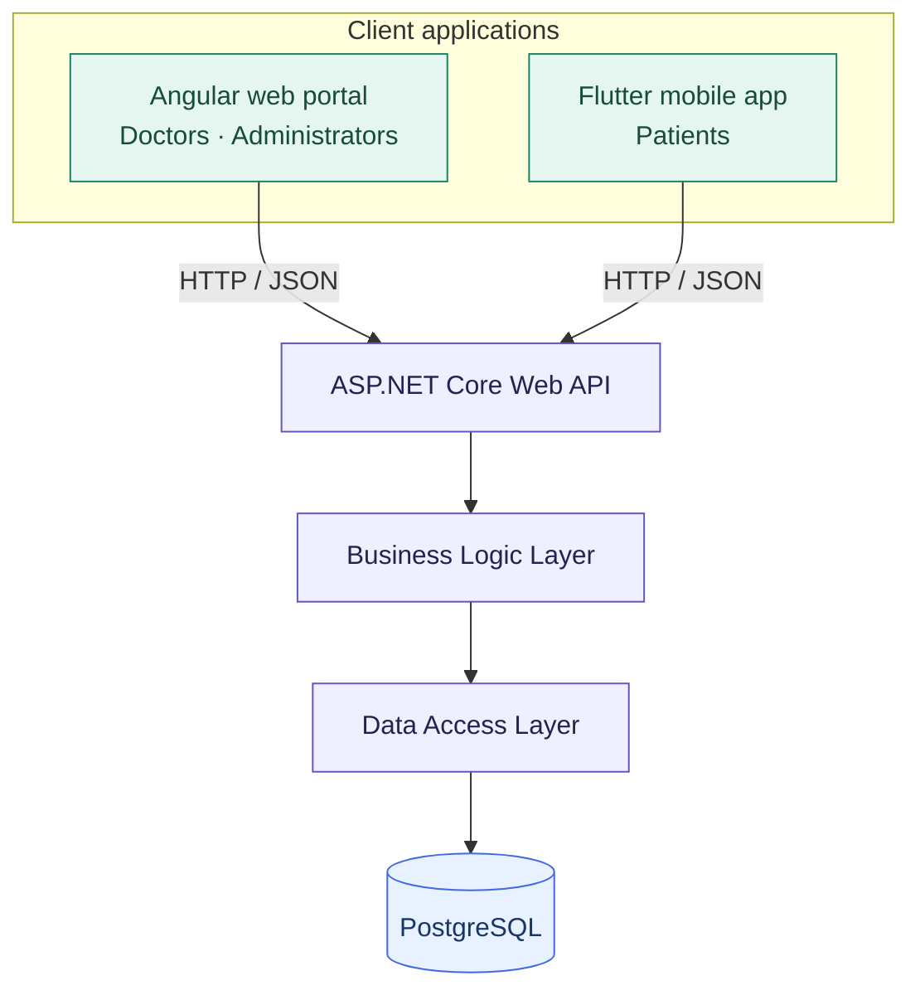

<div align="center">

# 💊 MedMinder

### Medication Adherence System

**One platform. Two applications. Three user roles.**

An Angular clinical portal and Flutter patient application connected through an ASP.NET Core API and PostgreSQL database.

<p>
  
  
</p>
<p>
  
  
  
</p>

[Repository](https://github.com/CS-U-G/medication-adherence) · [Backend deployment](https://medication-adherence.onrender.com/) · [Swagger endpoint](https://medication-adherence.onrender.com/swagger/index.html)

</div>

---

## Overview

**MedMinder** brings clinical medication management and patient-facing medication workflows into one project. Doctors and administrators use the **Angular web portal**; patients use the **Flutter mobile app**. Both clients communicate with the shared **ASP.NET Core API**, which connects to **PostgreSQL**.

| Experience | Intended user | Documented scope |
| :-- | :-- | :-- |
| **Clinical portal** · Angular | Doctors | Patient records and prescription workflows |
| **Administration** · Angular | Administrators | Doctor accounts and medication catalogue |
| **Patient app** · Flutter | Patients | Patient access and medication-facing experience |

## Architecture



The backend is split into **API**, **business logic** and **data access** projects. Database operations stay behind the API rather than being performed directly by either client.

## Application surface

The repository contains implementations and API contracts for **staff authentication**, **patient registration and retrieval**, **doctor account management**, **medication catalogue operations** and **prescription management**. The web portal has a shared staff sign-in entry point with distinct doctor and administrator workspaces.

The documented authentication routes are:

| Client | Endpoint | Request |
| :-- | :-- | :-- |
| Staff web portal | `POST /api/auth/web-login` | `email`, `password` |
| Patient access flow | `POST /api/patients/code-login` | `accessCode` |

*These are API routes, not a claim that every client workflow is fully integrated or deployed without errors.*

## Repository structure

```text
medication-adherence/
├── backend/
│   ├── MedicationAdherence.Api/   # ASP.NET Core API
│   ├── MedicationAdherence.BLL/   # Business logic
│   └── MedicationAdherence.DAL/   # Data access
├── web/
│   └── medication-adherence-admin/  # Angular portal
├── mobile/
│   └── medication_adherence/       # Flutter app
└── docs/                         # Project documentation
```

## Development

Start each application from its own project directory after installing the relevant **.NET**, **Node.js/npm** and **Flutter** toolchains and configuring the backend's PostgreSQL connection.

```bash
# API — from the repository root
dotnet run --project backend/MedicationAdherence.Api

# Angular — from the repository root
cd web/medication-adherence-admin
npm ci
npm start

# Flutter — from the repository root
cd mobile/medication_adherence
flutter pub get
flutter run
```

> Run the Angular and Flutter commands in **separate terminals** from the repository root. API URLs and backend credentials must be configured for the selected environment; do not commit secrets.

---

<div align="center">

**CS-U-G · Medication Adherence Project**

</div>
