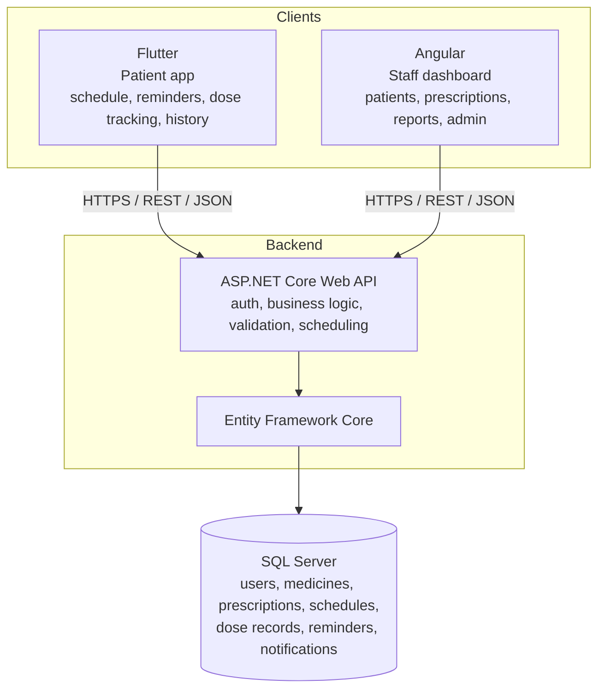
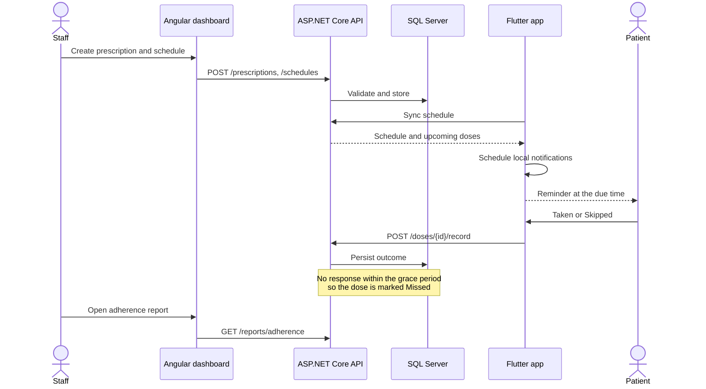
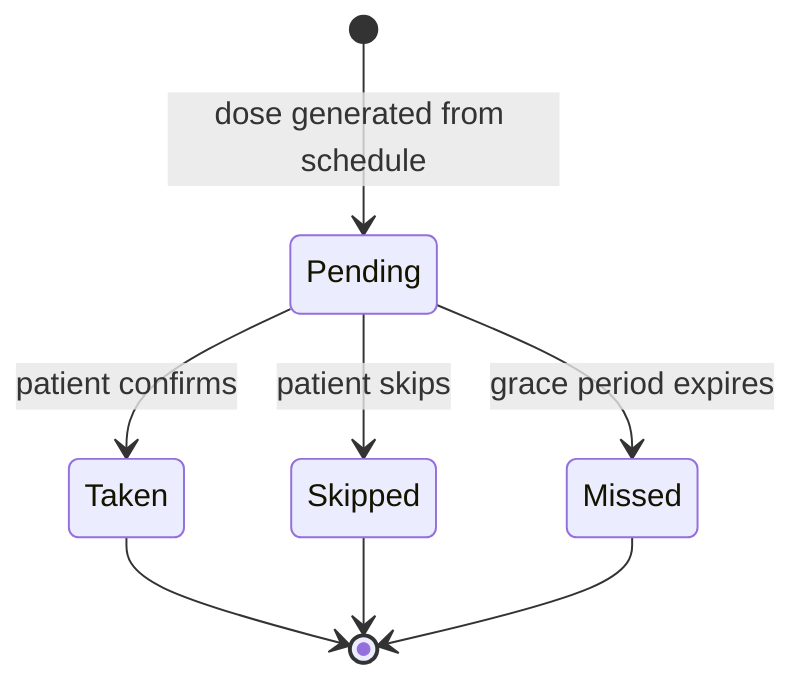
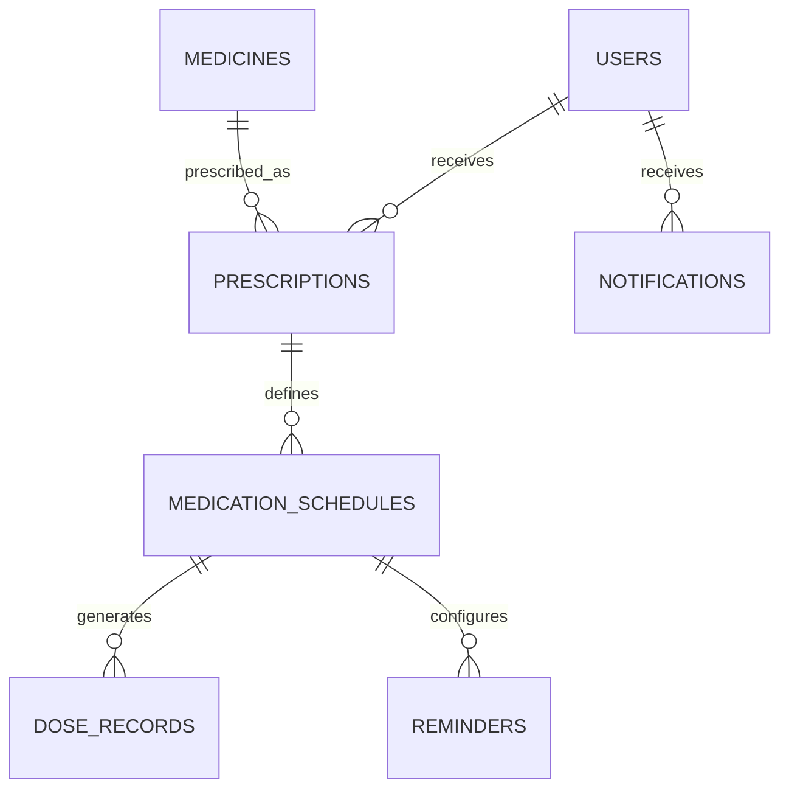

# Medication Adherence

> Helping patients take the right medicine at the right time, and helping clinicians see whether it is happening.

Medication Adherence is a full-stack platform made of three parts: a **Flutter** patient app, an **Angular** dashboard for healthcare staff, and an **ASP.NET Core** API backed by **SQL Server**.


---

## Table of contents

1. [The idea](#1-the-idea)
2. [Who uses it](#2-who-uses-it)
3. [Core features](#3-core-features)
4. [System architecture](#4-system-architecture)
5. [How a reminder works](#5-how-a-reminder-works)
6. [Data model](#6-data-model)
7. [API overview](#7-api-overview)
8. [Tech stack](#8-tech-stack)
9. [Repository structure](#9-repository-structure)
10. [Getting started](#10-getting-started)
11. [MVP scope and roadmap](#11-mvp-scope-and-roadmap)
12. [Design principles](#12-design-principles)
13. [Safety boundary](#13-safety-boundary)
14. [Documentation](#14-documentation)

---

## 1. The idea

Patients often miss or skip prescribed medication, and clinicians usually only find out at the next appointment, if at all. That gap is called **non-adherence**.

This project closes it in two directions:

- **For patients:** a simple mobile app that reminds them when a dose is due and lets them log it in one tap.
- **For clinicians:** a web dashboard where they manage prescriptions and schedules and see real adherence data: what was scheduled, what was taken, what was skipped, and what was missed.

Adherence is calculated from **recorded dose outcomes**, not from whether a notification was delivered. A reminder only shows that a message was sent; a dose record shows what the patient actually did.

## 2. Who uses it

| Role | Interface | What they do |
|---|---|---|
| **Patient** | Flutter mobile app | View their schedule, receive reminders, record doses, review history |
| **Staff** (doctor, nurse, pharmacist) | Angular dashboard | Manage patients, create prescriptions and schedules, review adherence reports |
| **Admin** | Angular dashboard | Manage staff accounts and the medicine catalogue |

The two frontends serve different audiences and are not duplicates. The mobile app is optimised for quick everyday use. The dashboard is a broader management tool.

## 3. Core features

| Feature | Description |
|---|---|
| **Medication reminders** | Doses, frequencies, start/end dates and reminder times; notifications when a dose is due |
| **Dose tracking** | Patients record each dose as *Taken* or *Skipped*; unanswered doses become *Missed*; timestamps and history are preserved |
| **Prescription management** | Authorised staff create and update prescriptions and attach schedules |
| **Adherence reports** | Scheduled vs. completed doses, missed doses and trends over a chosen period |
| **Access control** | JWT authentication, role-based authorisation, and ownership checks so patients only see their own data |

## 4. System architecture



**Architectural rules**

1. Both frontends talk to the **same API**. Neither connects to the database.
2. **Business rules live in the backend**: authorisation, ownership checks, missed-dose evaluation.
3. The API exposes **DTOs**, never database entities.
4. Routes are **versioned** (`/api/v1/...`).

**Backend layering**

```
Controllers  ->  Services  ->  Repositories  ->  DbContext (EF Core)  ->  SQL Server
  (HTTP)      (business rules)   (data access)
```

Cross-cutting concerns: `Middleware` (error handling, logging) and `Validators` (request validation).

## 5. How a reminder works

The server stores the **authoritative schedule**. The phone delivers reminders **locally**, so they still fire without an internet connection.



**Dose lifecycle**



A **schedule** is a rule ("every day at 08:00"). A **dose record** is one occurrence of that rule ("14 Oct at 08:00"). The backend generates individual dose records so adherence reports stay accurate.

**Mobile concerns handled explicitly:** Android notification and exact-alarm permissions, re-scheduling after a device restart, and time-zone or daylight-saving changes.

## 6. Data model

Seven principal tables. Primary keys are integer identities.



| Table | Purpose |
|---|---|
| `Users` | Patient and staff accounts (managed with ASP.NET Core Identity) |
| `Medicines` | Medicine catalogue: name, strength, form |
| `Prescriptions` | A medicine assigned to a patient, with instructions and dates |
| `MedicationSchedules` | Time of day and frequency for a prescription |
| `DoseRecords` | Actual dose outcomes: *Pending, Taken, Skipped, Missed* |
| `Reminders` | Reminder configuration for a schedule |
| `Notifications` | Notification history and read status |

Full field list and indexes: [docs/database-design.md](docs/database-design.md).

## 7. API overview

Base path `/api/v1`, JSON over HTTPS, JWT bearer authentication.

| Area | Endpoints |
|---|---|
| **Auth** | `POST /auth/register`, `POST /auth/login` |
| **Medications** | `GET /medications` |
| **Prescriptions** | `POST /prescriptions` |
| **Schedules** | `GET /schedules`, `POST /schedules`, `PUT /schedules/{id}` |
| **Doses** | `GET /doses/today`, `POST /doses/{id}/record` |
| **Reports** | `GET /reports/adherence` |
| **Notifications** | `GET /notifications` |

Interactive Swagger/OpenAPI documentation is available when the API runs in development. Details: [docs/api-specification.md](docs/api-specification.md).

## 8. Tech stack

| Layer | Technology |
|---|---|
| Patient app | Flutter, Dart |
| Staff dashboard | Angular, TypeScript |
| API | ASP.NET Core Web API, C# |
| ORM | Entity Framework Core |
| Database | SQL Server |
| Authentication | ASP.NET Core Identity, JWT |
| API docs | OpenAPI / Swagger |
| Testing | xUnit (backend), Flutter and Angular test tooling |
| Version control and CI | Git, GitHub, GitHub Actions |

## 9. Repository structure

A monorepo: one repository, three independent applications.

```
medication-adherence/
├── backend/
│   └── MedicationAdherence.Api/
│       ├── Controllers/  Data/  DTOs/  Models/  Services/
│       ├── Repositories/  Validators/  Middleware/  Migrations/
│       └── Program.cs
│   └── MedicationAdherence.Tests/
├── mobile/
│   └── medication_adherence/
│       └── lib/
│           ├── core/  models/  services/  repositories/  routing/
│           └── features/
│               ├── authentication/  dashboard/  medications/
│               └── reminders/  dose_tracking/  history/
├── web/
│   └── medication-adherence-admin/
│       └── src/app/
│           ├── core/  shared/
│           └── features/
│               ├── authentication/  dashboard/  patients/
│               └── prescriptions/  schedules/  reports/
├── docs/
├── scripts/
└── .github/workflows/
```

## 10. Getting started

**Prerequisites:** .NET SDK 8+, Flutter SDK, Node.js 20+ with the Angular CLI, and SQL Server (full, LocalDB or Docker).

**First-time setup**

```powershell
./scripts/setup.ps1 -Org com.yourname
```

**Configure the database** (keep secrets out of git):

```powershell
cd backend/MedicationAdherence.Api
dotnet user-secrets init
dotnet user-secrets set "ConnectionStrings:Default" "<your SQL Server connection string>"
dotnet user-secrets set "Jwt:Key" "<long random secret>"
dotnet ef database update
```

**Run each application**

```powershell
# API
dotnet run --project backend/MedicationAdherence.Api

# Staff dashboard
cd web/medication-adherence-admin
ng serve

# Patient app
cd mobile/medication_adherence
flutter run
```

## 11. MVP scope and roadmap

**The first release focuses on the core workflow:** authentication, medication schedules, reliable reminders, dose logging and basic reports.

**The MVP is done when:**

- [ ] A patient can log in and view their assigned schedule
- [ ] The app notifies the patient at the configured times
- [ ] The patient can record a dose outcome and the backend persists it
- [ ] Authorised staff can manage prescriptions and schedules
- [ ] Both frontends show consistent data from the same API
- [ ] Adherence reports are calculated from dose records

**Development sequence**

| Phase | Focus |
|---|---|
| 1 | Requirements and database design |
| 2 | Backend foundation: SQL Server, EF Core, migrations, auth, Swagger |
| 3 | Flutter MVP: login, medication list, today's doses, notifications, dose recording |
| 4 | Angular dashboard: patients, prescriptions, schedules, reports |
| 5 | Integration testing: API contracts, authorisation, time zones, duplicate requests, notifications |

**Later:** push notifications, caregiver accounts, refill reminders, richer analytics.

## 12. Design principles

- **Backend is the source of truth.** Clients display and submit; the API decides.
- **Adherence comes from dose records**, never from reminder delivery alone.
- **Security by default:** hashed passwords, HTTPS, role-based access, ownership checks on every patient record.
- **UTC everywhere** in storage; clients convert to local time.
- **Idempotent writes:** recording the same dose twice must not create duplicates.
- **Keep it simple first.** Stabilise the core workflow before adding features.

## 13. Safety boundary

> This application **records and reminds**. It must not independently prescribe medicines, change dosages, or recommend taking an extra dose after a missed reminder. Prescription changes are made only by appropriately authorised healthcare professionals.

This project is a software engineering project and is not a certified medical device. Do not rely on it for clinical decisions without proper regulatory review.

## 14. Documentation

| Document | Contents |
|---|---|
| [docs/requirements.md](docs/requirements.md) | Roles, use cases, validation rules |
| [docs/architecture.md](docs/architecture.md) | Layers, reminder strategy, dose generation |
| [docs/database-design.md](docs/database-design.md) | ER diagram, indexes, conventions |
| [docs/api-specification.md](docs/api-specification.md) | Endpoint contracts and conventions |

## License

To be decided (MIT is a common choice for portfolio projects).
