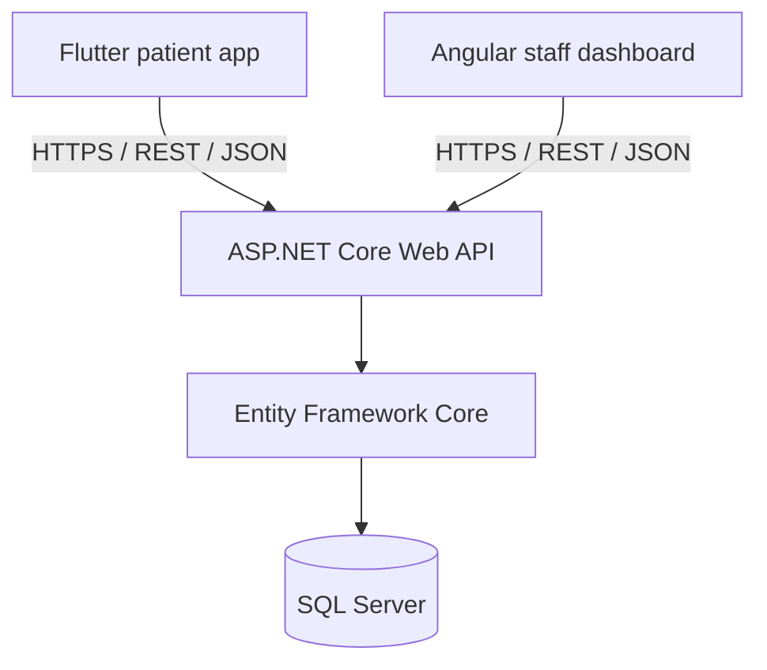

# Architecture

## Rules
- Frontends call the API only; database access is confined to the backend.
- Business rules (authorisation, ownership checks, missed-dose evaluation) live in the backend.
- Use DTOs for every request/response; never expose EF entities.
- Versioned routes: `/api/v1/...`.

## Backend layers
`Controllers` -> `Services` (business logic) -> `Repositories` (EF Core) -> `Data` (DbContext, migrations).
Cross-cutting: `Middleware` (error handling, logging), `Validators` (FluentValidation).

## Reminder strategy
The server holds the authoritative schedule. The phone schedules local notifications from synced data so reminders work offline. Handle explicitly on mobile:
- Android 13+ notification permission and exact-alarm permission
- Re-scheduling after device reboot
- Time-zone and DST changes
- Re-sync after schedule edits

## Dose records
A schedule is a rule; a dose record is one occurrence. A backend hosted service generates `DoseRecords` for upcoming days and flips unanswered ones to `Missed` after the grace period.

## Reminder flow
Staff create prescription -> define schedule -> backend validates and stores -> Flutter syncs -> local notifications -> patient records Taken/Skipped, or the backend marks Missed -> adherence history -> Angular reports.
